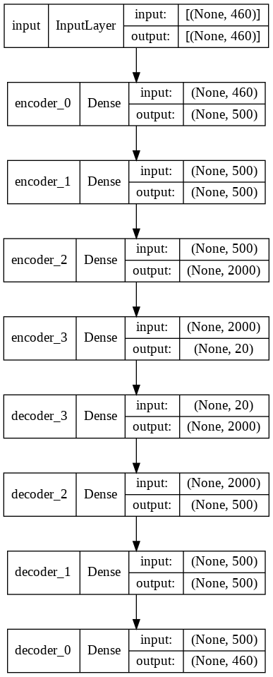

# Deep Embedded Clustering on HPC Monitoring Data

Unsupervised clustering of monitoring data from one compute node of the Marconi-100 supercomputer. The project compares classical clustering, clustering on autoencoder embeddings, and Deep Embedded Clustering (DEC).

## Course

Project work for the course "Artificial Intelligence in Industry" at the University of Bologna (Alma Mater Studiorum). The DEC implementation follows the DEC paper, [Unsupervised Deep Embedding for Clustering Analysis](https://arxiv.org/abs/1511.06335), and the [DEC-keras](https://github.com/XifengGuo/DEC-keras) reference code, both cited in the report.

## Dataset

- Monitoring data from Marconi-100, a supercomputer hosted at Cineca, collected with the ExaMon monitoring tool. There is one parquet file per compute node. Features cover core load, room temperature, fan speed, memory reads and writes, and more.
- The full dataset did not fit in Google Colab memory, so the project uses a single node file (`r206n05.gzip`): 15,310 samples and 460 features after dropping the `label` and `timestamp` columns.
- The target column `New_label` uses 0 for a normal node state and 2 for an anomalous state (mapped to 1). There are 14,931 normal and 379 anomalous samples (about 2.5% anomalous). Labels are used only for evaluation.
- All features are scaled with `MinMaxScaler`.
- The data is not included in this repository.

## Method

1. **Baselines.** K-means, a Gaussian mixture model (GMM), and agglomerative clustering, each with 2 clusters, on the scaled 460-d input.
2. **Autoencoder + clustering.** A dense autoencoder with layers 460-500-500-2000-k (ReLU hidden layers, MSE loss, SGD with learning rate 0.1 and momentum 0.9, batch size 128, 100 epochs). The same three algorithms are then run on the k-d embedding (k = 10 in the notebook).
3. **DEC.** The encoder of a pretrained autoencoder (k = 20) feeds a clustering layer that computes Student's t soft assignments `q`. Cluster centers are initialized with K-means on the embedding. The model then minimizes the KL divergence between `q` and the sharpened target distribution `p`, plus the reconstruction MSE (loss weights 0.5 and 1). Training uses SGD (learning rate 0.01, momentum 0.9) and batch size 128. The target `p` is updated every 140 iterations, with at most 1000 iterations. Training stops when fewer than 1% of cluster assignments change between updates (tolerance 0.01).

According to the report, the following settings were also tried: bottleneck sizes 10, 20, 50 and 100; tolerance 0.0001 to 0.1; update interval 100, 120 and 140; max iterations 1000, 2000 and 4000; KL loss weight 0.1, 0.3, 0.5 and 0.8; batch size 32, 64 and 128; and Adam versus SGD. Only the final configuration's results are recorded.

## Results

All scores are computed on the same 15,310 samples; there is no held-out split. Clustering accuracy matches clusters to labels with the Hungarian algorithm. For every method, the silhouette score is computed on the scaled input features. Values come from the notebook outputs unless marked otherwise.

| Method | Clustered features | Clustering accuracy | Silhouette |
|---|---|---|---|
| K-means | input (460-d) | 0.722 | 0.417 |
| GMM | input (460-d) | 0.524 | 0.189 |
| Agglomerative | input (460-d) | 0.68 (a) | 0.419 |
| K-means | autoencoder embedding (10-d) | 0.736 | 0.421 |
| GMM | autoencoder embedding (10-d) | 0.737 (b) | 0.420 |
| Agglomerative | autoencoder embedding (10-d) | 0.763 | 0.423 |
| DEC | autoencoder embedding (20-d), fine-tuned | 0.699 | 0.404 |

DEC also reaches a normalized mutual information (NMI) of 0.0032. The DEC row comes from the DEC notebook. The report gives these values as 0.69, 0.40 and 0.0032.

- (a) From the baseline report (`Report 3cfu.docx`). The notebook cell intended for this value scores the GMM predictions instead.
- (b) The stored output does not match the cell's current code, which scores the agglomerative labels. The baseline report gives the same value (0.74).

## Figures

Autoencoder used for pretraining (460-500-500-2000-20):

DEC model. The encoder output feeds both the decoder (reconstruction) and the clustering layer (2 soft assignments):

2-D t-SNE of the scaled input features, colored by DEC cluster (0 black, 1 purple; the color bar runs to 9, but only two clusters are used). The report captions this figure "cluster assignments in embedded space".

## Files

| Path | Contents |
|---|---|
| [`Deep_Embedding_Clustering_(DEC) .ipynb`](Deep_Embedding_Clustering_%28DEC%29%20.ipynb) | Data preparation, autoencoder pretraining (20-d), DEC training, t-SNE plot, evaluation |
| [`Autoencoder+ Clustering Algorithmsn/Autoencoder_+_Clustering_Techniques.ipynb`](Autoencoder%2B%20Clustering%20Algorithmsn/Autoencoder_%2B_Clustering_Techniques.ipynb) | Baselines on the input and on a 10-d autoencoder embedding |
| [`Autoencoder+ Clustering Algorithmsn/Report 3cfu.docx`](Autoencoder%2B%20Clustering%20Algorithmsn/Report%203cfu.docx) | Short report on the baseline comparison |
| [`Report.pdf`](Report.pdf) | Project report on DEC |
| [`saved weights/`](saved%20weights) | Keras weights of pretrained autoencoders with 10, 20, 50 and 100-d bottlenecks (`ae_weights_{10,20,50,100}d.h5`) |
| [`Images/`](Images) | Figures shown above |

## Reproducing

- Both notebooks were run on Google Colab with TensorFlow/Keras, scikit-learn and pandas.
- Both notebooks mount Google Drive and read `r206n05.gzip` from `/content/drive/MyDrive/HPC Dataset/`. To rerun them, you need access to the Marconi-100 data, and you must change this path.
- **Neither notebook loads `saved weights/`.** The DEC notebook trains the autoencoder for 100 epochs, saves the weights to `ae_weights_20d.h5` in a `results` folder on Google Drive, and reloads them from there before DEC training. The baseline notebook trains its own 10-d autoencoder and saves it to `ae_weights_dimred_10d.h5` on Drive.
- To skip pretraining, point `path` to the `saved weights` folder and skip the `autoencoder.fit(...)` cell. The files have the same layer names as the notebook model, and their sizes match the 460-500-500-2000-k architecture. However, nothing records which run produced them.
- No random seeds are set for K-means, weight initialization or t-SNE, so reruns will give somewhat different numbers.
